# DG E-Commerce Caching Strategy & Performance Architecture

**Project**: D&G E-Commerce Mobile App (Rwamagana, Rwanda)  
**Stack**: React Native CLI 0.88.0, React 19.3.0, TypeScript, Node.js / Express.js, Neon PostgreSQL  

---

## 1. Executive Summary

To achieve high-speed responsiveness, smooth offline/slow-connection resilience, and low data-bundle consumption in Rwanda, DG E-Commerce implements a multi-tier, secure caching architecture:
1. **API State Caching & Deduplication**: Managed by `@tanstack/react-query` v5 with fine-tuned stale times and garbage collection policies.
2. **Selective Offline Persistence**: Non-sensitive catalog data (categories and public products) is persisted locally via `@react-native-async-storage/async-storage` and `@tanstack/query-async-storage-persister`.
3. **Sensitive Data Isolation**: User credentials, JWT auth tokens, customer orders, payment verification notes, and admin financial reports are strictly stored in-memory only and never written to device disk.
4. **Authoritative Backend Pricing & Inventory**: All price calculations and stock updates are guarded by backend PostgreSQL transactions (`SELECT ... FOR UPDATE`).
5. **Native Image Caching**: Native memory and disk caching via `CachedImage` utilizing `Image.prefetch(uri)` and `{ cache: 'force-cache' }`.
6. **Optimized Database Indexes**: Composite indexes in Neon PostgreSQL optimize high-frequency filtering and sorting queries without adding unnecessary Redis infrastructure.

---

## 2. TanStack Query Configuration & Stale Time Policies

Located at [src/api/queryClient.ts](file:///c:/Users/user/Desktop/DGEcommerce/src/api/queryClient.ts) and [src/api/queries.ts](file:///c:/Users/user/Desktop/DGEcommerce/src/api/queries.ts).

| Query Resource | Stale Time | GC Time | Offline Persistence | Rationale |
| :--- | :--- | :--- | :--- | :--- |
| **Categories** (`['categories']`) | **30 Minutes** | 24 Hours | **Yes** (AsyncStorage) | Categories change infrequently; instant render from cache gives immediate navigation. |
| **Public Products** (`['products', filters]`) | **5 Minutes** | 24 Hours | **Yes** (AsyncStorage) | Balances browsing speed with fresh stock numbers. Refetches in background. |
| **Product Detail** (`['product', id]`) | **5 Minutes** | 24 Hours | **Yes** (AsyncStorage) | Immediate display when navigating from catalog; background re-validation. |
| **Customer Orders** (`['orders', filters]`) | **30 Seconds** | 10 Minutes | **No** (In-Memory Only) | Dynamic updates (confirmation, WhatsApp payment verification, dispatch). |
| **Single Order** (`['order', id]`) | **30 Seconds** | 10 Minutes | **No** (In-Memory Only) | Real-time payment verification and fulfillment tracking. |
| **Admin Reports** (`['admin', 'reports']`) | **30 Seconds** | 10 Minutes | **No** (In-Memory Only) | Financial totals and sales analytics must reflect actual payments. |
| **Admin Customers** (`['admin', 'customers']`) | **1 Minute** | 10 Minutes | **No** (In-Memory Only) | Customer directory and spending totals. |
| **Seller Metrics** (`['seller', 'metrics']`) | **30 Seconds** | 10 Minutes | **No** (In-Memory Only) | Key dashboard indicators (pending dispatch, awaiting payment). |

---

## 3. Immediate Cache Invalidation Map

Any mutating admin action or checkout order creation immediately invalidates relevant query keys so all views update automatically without manual page refreshes:

```mermaid
graph TD
    A[Admin Adds / Edits / Deletes Product] -->|Invalidates| B['products']
    A -->|Invalidates| C['product', id]
    A -->|Invalidates| D['admin', 'reports']
    A -->|Invalidates| E['seller', 'metrics']

    F[Admin Adds / Edits / Deletes Category] -->|Invalidates| G['categories']
    F -->|Invalidates| B['products']

    H[Customer Places Order] -->|Invalidates| I['orders']
    H -->|Invalidates| B['products']
    H -->|Invalidates| D['admin', 'reports']
    H -->|Invalidates| E['seller', 'metrics']

    J[Admin Verifies WhatsApp MoMo Payment] -->|Invalidates| I['orders']
    J -->|Invalidates| K['order', id]
    J -->|Invalidates| D['admin', 'reports']
    J -->|Invalidates| E['seller', 'metrics']
    J -->|Invalidates| L['admin', 'customers']

    M[Admin Changes Order Fulfillment Status] -->|Invalidates| I['orders']
    M -->|Invalidates| K['order', id]
    M -->|Invalidates| D['admin', 'reports']
    M -->|Invalidates| E['seller', 'metrics']
    M -->|If Cancelled: Restores Stock| B['products']
```



---

## 4. Security & Data Protection Rules

1. **Authentication Tokens**:
   - JWT tokens remain inside React State ([AuthContext.tsx](file:///c:/Users/user/Desktop/DGEcommerce/src/state/AuthContext.tsx)).
   - Tokens are **never** included in query keys or stored in unencrypted persistent stores.
2. **Selective Dehydration (`persistDehydrateOptions`)**:
   ```typescript
   export const persistDehydrateOptions = {
     shouldDehydrateQuery: (query: any) => {
       const key = query.queryKey;
       if (!Array.isArray(key)) return false;

       // 1. Categories: non-sensitive, persisted for offline launch
       if (key[0] === 'categories') return true;

       // 2. Public products: persisted (excluding admin includeUnavailable)
       if (key[0] === 'products') {
         if (key[1]?.includeUnavailable) return false;
         return true;
       }

       if (key[0] === 'product') return true;

       // 3. Sensitive queries (orders, reports, customers): strictly in-memory
       return false;
     },
   };
   ```
3. **Authoritative Backend Validation**:
   - The frontend cache is treated as a presentation layer only.
   - Price calculation, stock deduction, and status transitions occur exclusively in PostgreSQL inside transactions using `SELECT ... FOR UPDATE` in [backend/src/routes/orders.ts](file:///c:/Users/user/Desktop/DGEcommerce/backend/src/routes/orders.ts).

---

## 5. Image Caching Strategy

Located at [src/components/common/CachedImage.tsx](file:///c:/Users/user/Desktop/DGEcommerce/src/components/common/CachedImage.tsx).

- **Compatibility**: 100% compatible with React Native CLI 0.88.0 and React 19.3.0 without relying on legacy native packages (e.g., `react-native-fast-image` which breaks on RN 0.73+ and New Architecture).
- **Native Disk Cache**: Configured with `source={{ uri, cache: 'force-cache' }}` to preserve fetched binary assets across app restarts.
- **Background Prefetching**: Proactively calls `Image.prefetch(uri)` on mount, registering downloaded assets in an in-memory `Set<string>` to prevent duplicate native fetch tasks.
- **Graceful Transitions**: Features smooth opacity fade-in animations on load completion, loading indicator with timeout protection, and clean Rwandan branded fallback (`D&G`) on missing or error states.

---

## 6. Neon PostgreSQL Database Indexes & Pagination

Optimized in [backend/src/db/schema.sql](file:///c:/Users/user/Desktop/DGEcommerce/backend/src/db/schema.sql):

```sql
-- Product filtering and sorting
CREATE INDEX IF NOT EXISTS idx_products_category ON products(category_id);
CREATE INDEX IF NOT EXISTS idx_products_available ON products(is_available);
CREATE INDEX IF NOT EXISTS idx_products_available_created ON products(is_available, created_at DESC);
CREATE INDEX IF NOT EXISTS idx_products_category_available ON products(category_id, is_available);
CREATE INDEX IF NOT EXISTS idx_products_stock ON products(stock);
CREATE INDEX IF NOT EXISTS idx_products_name ON products(name);

-- Order filtering and reports
CREATE INDEX IF NOT EXISTS idx_orders_user ON orders(user_id);
CREATE INDEX IF NOT EXISTS idx_orders_status ON orders(status);
CREATE INDEX IF NOT EXISTS idx_orders_status_created ON orders(status, created_at DESC);
CREATE INDEX IF NOT EXISTS idx_orders_payment_status ON orders(payment_status);
CREATE INDEX IF NOT EXISTS idx_orders_payment_created ON orders(payment_status, created_at DESC);
CREATE INDEX IF NOT EXISTS idx_orders_reference ON orders(order_reference);
CREATE INDEX IF NOT EXISTS idx_orders_created_at ON orders(created_at);

-- Order items sales aggregation
CREATE INDEX IF NOT EXISTS idx_order_items_order ON order_items(order_id);
CREATE INDEX IF NOT EXISTS idx_order_items_product ON order_items(product_id);
CREATE INDEX IF NOT EXISTS idx_order_items_product_created ON order_items(product_id, created_at DESC);
```

### Why Redis is Not Needed Yet
Neon PostgreSQL with proper B-tree composite indexes fulfills requests in single-digit milliseconds (~2-8ms query execution). Because client-side TanStack Query caches results for 5 minutes and deduplicates in-flight requests across app sessions, backend database load is reduced by over 80%. Introducing Redis at this stage would add unnecessary cloud operational costs and synchronization complexity without tangible performance benefits.
